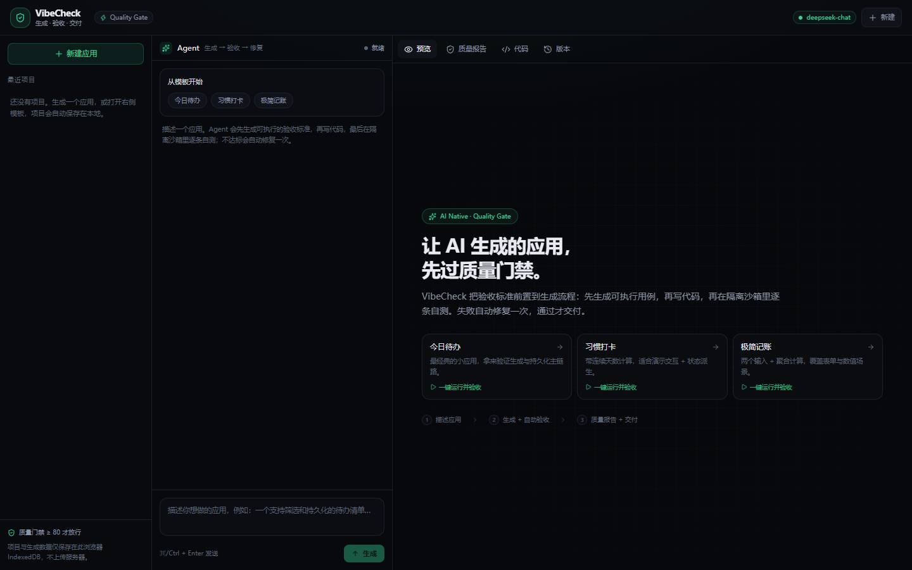
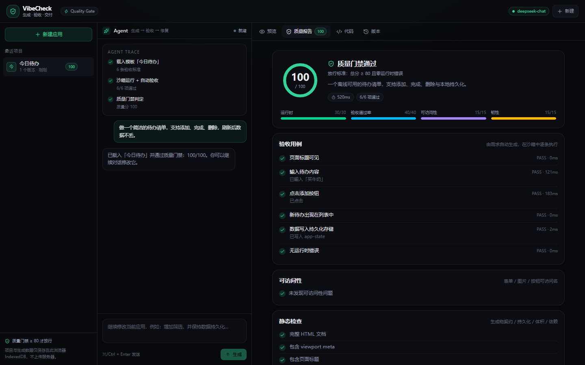
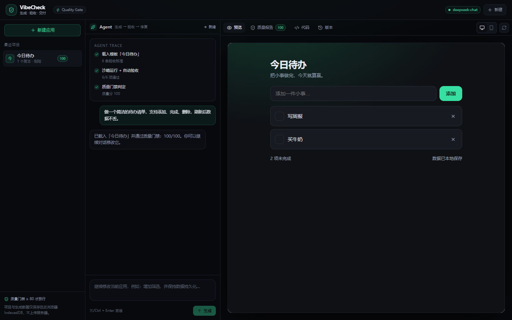

# VibeCheck

> 让 AI 生成的应用，先过质量门禁。

VibeCheck 是一个“会自我验收”的 AI 应用生成器：输入一句话，Agent 先生成可执行的验收标准，再流式编写单文件 Web 应用，最后在隔离沙箱里逐条自测。失败会自动修复一次，通过质量门禁才交付。

它不是一个“生成完就结束”的 Demo：验收标准被前置到生成流程，测试结果会变成可复用的质量报告和 Playwright 用例。

> 在线体验：https://expulsion-lifting-urging.ngrok-free.dev （ngrok 免费版首次打开点 **Visit Site**；登录页可一键使用演示账号）  
> 源码：https://github.com/xxstar2216/vibecheck  
> 面向 HR / 非技术读者的简版介绍：[docs/PROJECT-INTRO.md](docs/PROJECT-INTRO.md)

## 与 Atoms 的关系

Atoms 是深度赋智的产品，也是这道笔试的**产品形态参考**：题目要求做一个“具备类似能力与交互体验”的 Demo，而不是接入 Atoms 或复刻其代码。

VibeCheck 是独立实现：不调用 Atoms API、不嵌入 Atoms、不使用其品牌。差异化在于把“生成后的质量验收与自动修复”做成一等公民。Atoms 的 $70 额度（如到账）只用于体验参考产品、写对比笔记，不是项目依赖。



## 核心流程

1. **描述**：输入一句话，或打开一个预置模板
2. **出规格**：Spec Agent 产出应用规格 + 4-6 条可执行验收标准
3. **写代码**：Code Agent 流式生成单文件 HTML，指定 `data-testid` 与持久化契约
4. **跑验收**：在 1024×768 的隔离沙箱里逐条执行验收，同时捕获运行时错误与可访问性问题
5. **门禁判定**：总分 ≥ 80 且零运行时错误才放行；不达标自动修复一次，仍不达标可在报告里一键继续修复
6. **迭代**：继续对话修改，保留版本历史；修改时复用原验收标准做回归
7. **交付**：导出 HTML、质量报告 JSON、Playwright 用例

## 3 分钟评审路径

1. **注册登录**：右上角「登录 / 注册」；登录页可一键使用演示账号（`demo@vibecheck.dev` / `demo1234`）。登录后项目保存到云端。
2. **Agent 交互**：输入需求 → Spec Agent 给出验收标准 → 确认 → Build / QA / Gate。
3. **数据持久化**：刷新页面；退出后重新登录（或换无痕窗口），项目仍在。
4. **页面美观度**：预览页切换桌面 / 手机宽度；3 个模板卡片覆盖待办、打卡、记账。
5. **代码管理**：代码 → 编辑 → 保存并验收；版本 → diff / 回滚；下载 ZIP。
6. **产物预览**：预览 → 分享 → 新标签 / 全屏 / 二维码。



## 功能

- **多角色 Agent**：Spec / Build / QA / Gate；生成前可确认/修改 Spec，生成后给后续建议
- **质量门禁**：运行时错误、验收通过率、可访问性、韧性四类检查
- **自动修复 + 手动继续修复**：失败后带结构化失败报告自动修复一次；仍不达标可在质量报告里一键继续修复
- **质量报告可复制**：一键复制 Markdown 摘要，直接贴进文档或聊天
- **隔离沙箱**：`sandbox="allow-scripts allow-forms"`（不含 `allow-same-origin`），生成代码无法访问父页面
- **安全存储桥**：生成代码通过 `window.__atoms.storage` 持久化，父页面用 IndexedDB / 服务端落盘
- **版本管理**：生成 / 修改 / 自动修复 / 模板都会留下版本，可回看代码与报告
- **代码管理**：在线编辑代码、保存为新版本、版本 diff、ZIP 导出（HTML / 报告 / Playwright）
- **分享与预览**：公开分享页 + 二维码；新标签页、全屏预览
- **访客 + 可选账号**：不登录即可使用；注册/登录后项目/版本/报告存服务端 SQLite，跨浏览器继续
- **预置模板**：待办、习惯打卡、极简记账；**不配置模型 Key 也能完整体验质量门禁**
- **可交付物**：HTML、报告 JSON、Playwright `.spec.ts`、ZIP、分享页



## 质量评分

| 维度 | 权重 | 检查内容 |
| --- | --- | --- |
| 运行时 | 30 | 未捕获异常、未处理的 Promise rejection、`console.error` |
| 验收通过率 | 40 | 由需求生成的 4-6 条可执行用例 |
| 可访问性 | 15 | 表单可访问名、图片 alt、按钮可访问名、`html lang` |
| 韧性 | 15 | 完整文档、viewport、title、`data-testid`、存储桥、响应式、空状态、体积、外部依赖 |

放行规则：**总分 ≥ 80 且零运行时错误**。分数与每一项证据都会写进质量报告。

## 技术栈

- **前端**：Next.js 15（App Router）+ React 19 + TypeScript + Tailwind CSS 4
- **后端**：Next.js Route Handlers（Node.js），流式返回
- **模型**：任意兼容 OpenAI Chat Completions 的服务（默认 DeepSeek）
- **沙箱**：`iframe srcdoc` + 不透明源 sandbox + postMessage
- **认证**：邮箱 + 密码（scrypt）+ HttpOnly 会话 Cookie
- **存储**：访客用 IndexedDB；登录用户用服务端 SQLite（`node:sqlite`）保存项目 / 版本 / 报告
- **分享**：公开快照页 `/share/[id]` + 二维码
- **部署**：本地 / 香港 VPS（SQLite 需要持久磁盘）；Vercel Serverless 需改用 Postgres

```mermaid
flowchart LR
  U[用户] --> W[Next.js Workspace]
  W -->|POST /api/spec| S[Spec Agent]
  W -->|POST /api/generate| G[Code Agent]
  W -->|POST /api/repair| R[Repair Agent]
  S & G & R --> L[LLM API]
  W --> P[预览 iframe]
  W --> T[验收执行器 iframe]
  T -->|postMessage 验收结果| W
  W --> Q[质量报告]
  W -->|访客| IDB[(IndexedDB)]
  W -->|登录| DB[(SQLite 用户 / 项目 / 分享)]
  W -->|分享| SH[/share/:id]
```

## 快速开始

```bash
cd vibecheck
npm install
cp .env.example .env.local
# 编辑 .env.local，填入 LLM_API_KEY
npm run dev
```

打开 <http://localhost:3000>。

> 没有 API Key 也可以直接点三个预置模板，完整走一遍“沙箱验收 → 质量报告 → 版本”的流程。  
> 不登录也能使用全部生成能力；登录后项目会写入 `data/vibecheck.db`，跨浏览器继续（该目录已 gitignore）。

### 环境变量

| 变量 | 默认值 | 说明 |
| --- | --- | --- |
| `LLM_BASE_URL` | `https://api.deepseek.com/v1` | OpenAI 兼容接口地址 |
| `LLM_API_KEY` | 空 | 服务端密钥，不会下发到浏览器 |
| `LLM_MODEL` | `deepseek-flash` | 模型 ID，必须与服务商控制台完全一致 |
| `DAILY_LIMIT` | `20` | 每 IP 每日调用上限（含修复） |

填好 `.env.local` 后，先运行一次配置检查：

```bash
npm run check:llm
```

它会验证 base URL、模型 ID 和 key 是否匹配，只打印脱敏后的 key；如果模型不存在，会直接显示服务商返回的错误。

## 部署

> 当前在线演示通过 ngrok 隧道暴露本地服务。账号和项目使用服务端 SQLite，需要一个**持久磁盘**。

**本地 / 香港 VPS（推荐，SQLite 可用）**

```bash
npm ci
# 配置 .env.local
npm run build
npm start
```

**Vercel（可选）**

Vercel Serverless 的文件系统不持久，直接使用 SQLite 会丢数据；需要把 `src/lib/db.ts` 换成 Postgres / Supabase 等托管数据库。当前 Demo 的演示链接走 ngrok + 本地服务。

> 限流是进程内内存实现，适合 Demo；生产环境应换成 Upstash Redis 等共享存储。

## 安全设计

- API Key 只在服务端读取，浏览器不接触
- 生成代码运行在不透明源 iframe 中（不加 `allow-same-origin`），不能读取父页面 DOM / Cookie
- 生成代码只能通过 `postMessage` 存储桥读写数据，父页面做 key 长度与作用域限制
- 单次生成有 `max_tokens` 上限，服务端有每 IP 每日配额
- 生成物禁止外部网络依赖；静态检查会把外部请求标黄
- 不使用 `eval` / `document.write`，生成提示中明确禁止

## 测试

```bash
npm run build          # 类型检查 + 生产构建
npm start              # 启动生产服务（另开终端）

npm run smoke            # 模板 → 验收 → 预览 → 刷新持久化
npm run smoke:templates  # 另外两个模板 + 移动端溢出检查
npm run smoke:generation # 浏览器内 mock，验证生成 → 失败 → 自动修复 → 通过
npm run smoke:real       # 真实模型端到端（需要 .env.local + 运行中的服务）
npm run smoke:repair     # mock 模型：失败 → 一键继续修复 → 通过
npm run smoke:v2         # 注册/登录 → 云持久化 → 代码编辑/diff/ZIP → 分享 → 登出/再登录
npm run smoke:spec       # mock 模型：Spec 确认 → 多角色 Agent → 自动修复 → 通过
```

还可以用本地 mock LLM 验证**真实服务端链路**（含 SSE 流式解析）：

```bash
node scripts/mock-llm.mjs
# 另开终端：
LLM_BASE_URL=http://localhost:4010/v1 LLM_API_KEY=test LLM_MODEL=mock-model npm start -- -p 3002
# 再另开终端：
APP_URL=http://localhost:3002 node scripts/smoke-live.mjs
```

Smoke 脚本使用本机 Edge（`playwright-core`，不下载浏览器）。如果路径不同，修改脚本顶部的 `edge` 常量。

**已验证**：

- 3 个预置模板均 100 分通过
- 真实模型 `deepseek-flash`：待办 prompt，约 76s，首版未通过 → 自动修复 1 次 → **100/100（7/7 项验收）**
- **账号**：注册 → 登录 → 登出 → 再登录；访客模式可用；登录后项目写服务端 SQLite，刷新/重登仍在
- **代码管理**：在线编辑 → 保存并重新验收 → 新版本 → 版本 diff → ZIP 下载
- **分享/预览**：分享页 + 二维码 + 新标签页 + 全屏预览
- **Agent**：Spec 确认 → Spec/Build/QA/Gate 多角色 Trace → 自动修复 → 通过（mock 模型）
- 沙箱内添加数据后刷新预览，数据仍在
- 移动端 390px 无横向溢出
- 最终版本零运行时错误；如果控制台里看到首版的报错，那是被自动修复替换掉的临时版本

## 目录结构

```
src/app/api/          # spec / generate / repair / health / auth / projects / share
src/app/login/        # 登录 / 注册
src/app/share/[id]/   # 公开分享页
src/components/       # Workspace、ChatPanel、CodePanel、QualityPanel、PreviewFrame、ShareModal ...
src/lib/quality.ts    # 沙箱探针、测试 harness、静态检查、评分、Playwright 导出
src/lib/db.ts         # SQLite schema：users / sessions / projects / shares
src/lib/auth.ts       # scrypt 密码哈希 + HttpOnly 会话
src/lib/storage.ts    # 访客 IndexedDB + 登录用户服务端项目同步
src/lib/demoApps.ts   # 3 个预置模板
src/lib/prompts.ts    # Spec / Code / Repair 提示词
data/                 # SQLite 数据（已 gitignore）
scripts/              # Playwright smoke 与截图脚本
docs/                 # 设计说明与截图
```

## 已知限制与下一步

**已做**：生成、迭代、版本、质量门禁、自动修复、3 个模板、导出、移动端、无 Key 演示模式；访客 + 可选账号、云持久化、代码编辑/diff/ZIP、分享页/二维码、多角色 Agent + Spec 确认。

**没做 / 限制**：

- 只生成单文件 HTML，不是完整多文件工程（换来秒级渲染与零构建沙箱）
- 浏览器内 mini-runner 的可信度低于真实 Playwright（换来零基础设施）
- 自动修复只做 1 轮（控制成本与延迟）
- 失败的首版不会进入版本历史，只保留最终版本与 Agent Trace 证据
- 分享是公开快照：没有权限管理、撤回、密码
- 账号没有邮箱验证、找回密码、第三方登录
- SQLite 是单实例文件库，适合本地 / VPS；Vercel Serverless 需换 Postgres
- 编辑时复用原验收标准做回归，暂不自动扩展新验收项

**下一步优先级**：

- P0：20 条 golden prompt 的评估集 + 回归看板；把 Playwright 用例接入 CI
- P1：多文件工程 + WebContainer；分享权限/撤回；邮箱验证
- P2：视觉回归、模型 A/B、单次成功生成成本、线上遥测

详见 [docs/DESIGN.md](docs/DESIGN.md)。

## 注意

`JD_doc/`（岗位信息与笔试题）是私有面试材料，**不要提交到 public 仓库**。根目录 `.gitignore` 已将其排除。
